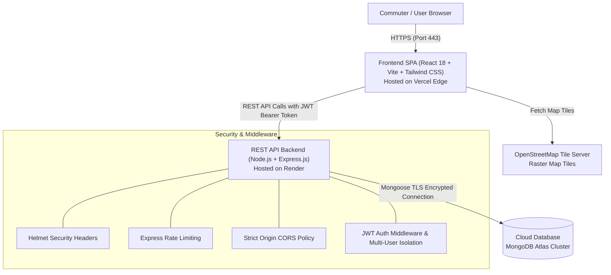

# SafeRoute — Women Safety & Emergency Assistance Platform

A modern, full-stack MERN (MongoDB Atlas, Express.js, React 18, Node.js) web application engineered to provide women and vulnerable commuters with rapid emergency assistance, trusted contact network coordination, consent-based geolocation broadcasting, interactive safety resource mapping, and actionable legal literacy.

---

## 📌 Project Overview & Abstract

### Problem Statement
Personal safety during daily commutes, late-night transit, and unfamiliar urban environments remains a significant concern. Many existing safety tools either suffer from intrusive continuous background tracking, complex multi-step navigation during crises, or a lack of transparent local safety resource information (police outposts, 24/7 hospitals, safe havens).

### Objectives
1. **Rapid Crisis Beacon**: Provide an intuitive, high-visibility Emergency SOS trigger with one-click geolocation acquisition.
2. **Privacy-First Consent**: Enforce explicit, consent-driven GPS acquisition without non-consensual background surveillance.
3. **Guardian Coordination**: Enable users to curate a personal network of verified emergency contacts with direct dial and messaging shortcuts.
4. **Community Resource Mapping**: Offer an interactive OpenStreetMap interface showing nearby verified emergency services, with real-time distance calculations.
5. **Legal & Preventative Empowerment**: Deliver structured, searchable safety guides and constitutional legal rights (Zero FIR, Free Legal Aid, Workplace Protections).
6. **Ethical Academic Transparency**: Strictly demarcate demonstration features from real external emergency dispatch to avoid generating false panic.

---

## 🏗️ System Architecture



---

## 🌟 Key Features

- **🚨 One-Tap Emergency SOS**: Instant distress alert recording with real-time GPS coordinates, accuracy radius, and simulated delivery logging.
- **👥 Trusted Guardian Circle**: Secure CRUD management for designated family members, peers, and mentors with search and quick-dial actions.
- **🗺️ Interactive Safety Map**: OpenStreetMap + Leaflet integration with proximity calculation (Haversine formula), radius filters, and categorized emergency markers.
- **📋 Auditable Incident Log**: Historical emergency timeline with status filtering (Active, Resolved, Cancelled), date picker, and OpenStreetMap pin links.
- **📚 Safety Guides & Legal Rights**: Categorized guide library covering transit safety, cyber defense, crisis de-escalation, and Indian constitutional protections (Zero FIR, Article 39A).
- **🔒 Profile & Account Settings**: Profile customization with server-side validation and field immutability guards (email, password, role tampering prevention).
- **🛡️ Production Hardened**: Helmet HTTP headers, DoS payload size limits (100kb), brute-force rate limiters, and complete stack trace suppression.

---

## 📊 Database Models

| Model | Collection | Key Fields | Purpose |
|---|---|---|---|
| **User** | `users` | `name`, `email` (unique), `password` (bcrypt hash), `phone`, `role`, `createdAt` | Authentication, JWT payload generation, and identity management. |
| **TrustedContact** | `trustedcontacts` | `user` (ref: User), `name`, `phone`, `relationship`, `timestamps` | Designating guardian circle members scoped strictly per user. |
| **EmergencyEvent** | `emergencyevents` | `user` (ref: User), `latitude`, `longitude`, `accuracy`, `status` (active/resolved/cancelled), `alertMode` (demo), `deliveryDetails` | Auditable timestamped emergency incident records. |
| **SafetyResource** | `safetyresources` | `name`, `category` (police/hospital/safe_haven), `latitude`, `longitude`, `address`, `phone`, `operatingHours`, `isDemo` | Open-source emergency places for interactive mapping. |

---

## 🔌 API Endpoints Reference

### Authentication & Profile (`/api/auth`)
| Method | Endpoint | Access | Description | Rate Limited |
|---|---|:---:|---|:---:|
| `POST` | `/api/auth/register` | Public | Register new user account | Yes (15 / 15 min) |
| `POST` | `/api/auth/login` | Public | Authenticate user & receive JWT token | Yes (15 / 15 min) |
| `GET` | `/api/auth/me` | Protected | Fetch current authenticated user session | No |
| `PATCH` | `/api/auth/profile` | Protected | Update profile name and phone (email immutable) | No |

### Trusted Contacts (`/api/contacts`)
| Method | Endpoint | Access | Description |
|---|---|:---:|---|
| `POST` | `/api/contacts` | Protected | Add new trusted contact to user circle |
| `GET` | `/api/contacts` | Protected | List all contacts belonging to authenticated user |
| `GET` | `/api/contacts/:id` | Protected | Retrieve specific contact details (403 on cross-user) |
| `PUT` | `/api/contacts/:id` | Protected | Update existing contact (403 on cross-user) |
| `DELETE`| `/api/contacts/:id` | Protected | Delete contact from user circle (403 on cross-user) |

### Emergency SOS (`/api/sos`)
| Method | Endpoint | Access | Description | Rate Limited |
|---|---|:---:|---|:---:|
| `POST` | `/api/sos` | Protected | Trigger new Emergency SOS event | Yes (15 / 1 min) |
| `GET` | `/api/sos/history` | Protected | Retrieve authenticated user's incident history | No |
| `GET` | `/api/sos/active` | Protected | Query currently active emergency event | No |
| `GET` | `/api/sos/:id` | Protected | Fetch specific incident audit details | No |
| `PATCH` | `/api/sos/:id/resolve`| Protected | Mark active incident as safely resolved | No |
| `PATCH` | `/api/sos/:id/cancel` | Protected | Cancel false-alarm incident | No |

### Safety Resources (`/api/resources`)
| Method | Endpoint | Access | Description |
|---|---|:---:|---|
| `GET` | `/api/resources` | Protected | List demo safety resources with optional `category`, `lat`, `lng`, `radius` |
| `GET` | `/api/resources/:id` | Protected | Fetch specific safety resource by MongoDB ObjectId |

### System Health
| Method | Endpoint | Access | Description |
|---|---|:---:|---|
| `GET` | `/api/health` | Public | Live server status, environment mode, and uptime timestamp |

---

## 💻 Local Installation & Setup

### 1. Prerequisites
- **Node.js** v18+ installed
- **Git** installed
- **MongoDB** running locally (`127.0.0.1:27017`) or a free [MongoDB Atlas](https://www.mongodb.com/atlas) connection URI

### 2. Clone Repository
```bash
git clone https://github.com/your-username/SafeRoute.git
cd SafeRoute
```

### 3. Backend Setup
```bash
cd server
cp .env.example .env
# Configure MONGODB_URI and JWT_SECRET in server/.env
npm install
npm run dev
```
*Backend runs on `http://localhost:5000`.*

### 4. Frontend Setup
In a new terminal:
```bash
cd client
cp .env.example .env
# VITE_API_BASE_URL=http://localhost:5000/api
npm install
npm run dev
```
*Frontend runs on `http://localhost:5173`.*

---

## 🧪 Automated Testing Suite

SafeRoute features 96 passing automated tests covering all modules:

```bash
# Run Authentication Suite (10 tests)
cd server && npm run test:auth

# Run Trusted Contacts CRUD & Security Suite (16 tests)
cd server && npm run test:contacts

# Run Emergency SOS & Geolocation Lifecycle Suite (17 tests)
cd server && npm run test:sos

# Run Safety Resources & Proximity Suite (11 tests)
cd server && npm run test:resources

# Run Incident History, Profile & Immutability Suite (22 tests)
cd server && npm run test:phase6

# Run Production Hardening, Helmet, CORS & Payload Suite (20 tests)
cd server && npm run test:hardening

# Verify Frontend Production Build
cd client && npm run build
```

---

## 🚀 Cloud Deployment

Detailed step-by-step instructions are provided in [`DEPLOYMENT_GUIDE.md`](./DEPLOYMENT_GUIDE.md).

- **Database**: MongoDB Atlas M0 Free Cluster (`MONGODB_URI`)
- **Backend**: Render Free Web Service with Node runtime
- **Frontend**: Vercel SPA with `client/vercel.json` rewrite configuration

---

## 📑 Project Documentation Index

- **[Deployment Guide](./DEPLOYMENT_GUIDE.md)**: Cloud provisioning steps for Atlas, Render, and Vercel.
- **[Security Audit Checklist](./SECURITY_CHECKLIST.md)**: Threat modeling, rate limits, JWT trade-offs, and multi-user isolation verification.
- **[Demonstration & Viva Script](./DEMO_SCRIPT.md)**: Step-by-step examiner presentation script with model viva Q&A.
- **[Project Completion Report](./PROJECT_COMPLETION_REPORT.md)**: Comprehensive academic completion report and technical specifications.

---

## 👥 Project Team

| Name | Roll / Student ID | Contribution Focus |
|---|---|---|
| **[Student 1 Name]** | `[Roll Number]` | Full-Stack Architecture, Express API & Hardening |
| **[Student 2 Name]** | `[Roll Number]` | Frontend UI/UX, Leaflet Safety Map & Routing |
| **[Student 3 Name]** | `[Roll Number]` | Emergency SOS Geolocation Engine & Testing Suite |
| **[Project Guide / Mentor]** | `[Designation / Dept]` | Faculty Project Supervisor & Architecture Review |

---

## ⚠️ Academic Safety & Ethical Notice

SafeRoute was designed and built as a computer engineering college project. In life-threatening emergencies, never rely solely on an academic web application—call official local emergency dispatch services directly:
- **India**: **112** (National Emergency), **1091** (Women Safety Helpline), **181** (Women in Distress), **1930** (Cyber Crime)
- **USA / Canada**: **911** | **United Kingdom**: **999** | **European Union**: **112**
